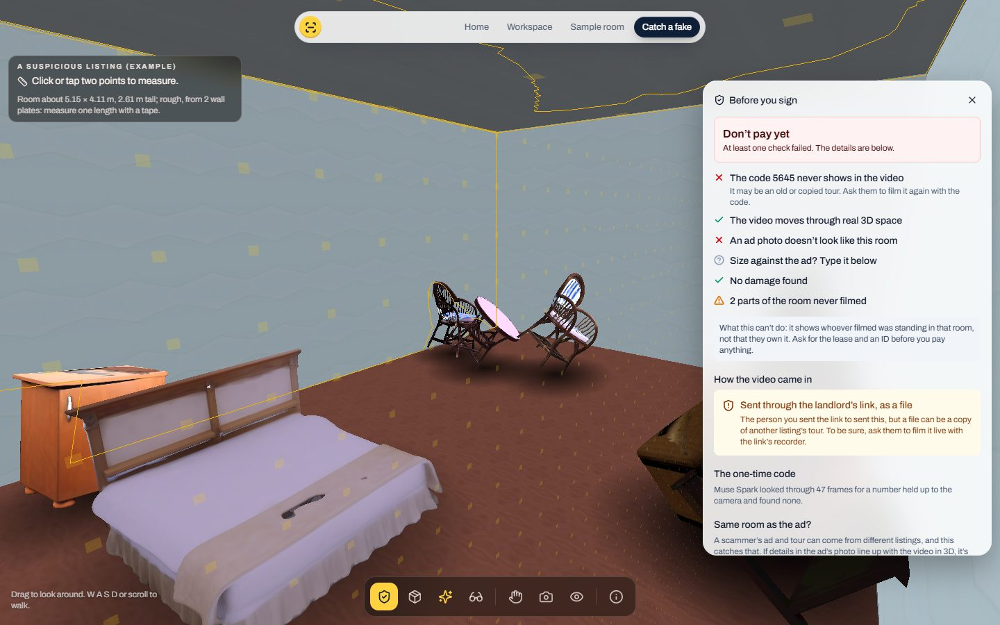
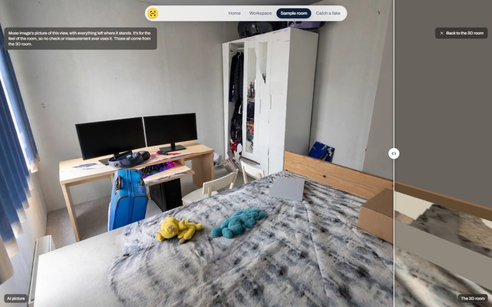
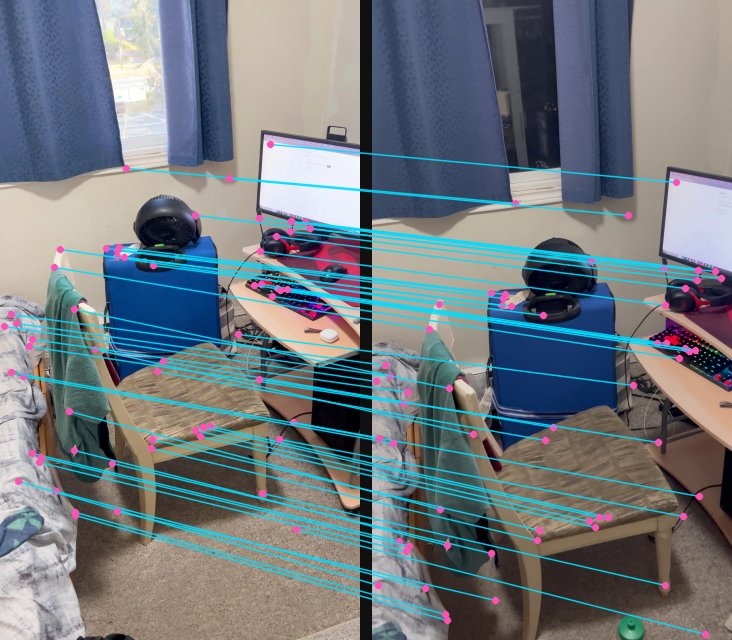
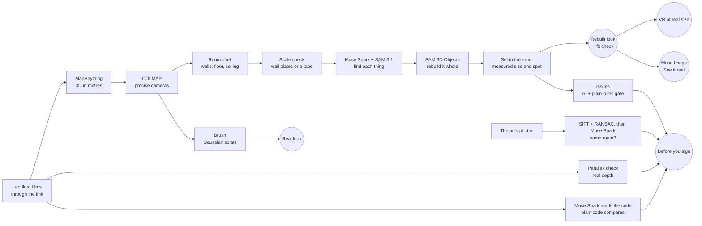

# SightSeen

**See the room before you sign.** A landlord films a room with one link. SightSeen turns the video into a 3D room at real
size that a student can walk, measure, fill with their own things, step into in VR, and check for the signs of a rental
scam.

**[Try it live](LIVE_LINK)** · no sign-in · walk a sample room, watch it catch a fake, or start your own

Built for Meta's Global AI Developer Hackathon by Sidharth Nair and Trinidad Laguardia, with MapAnything, Muse Spark,
Muse Image, SAM 3.1 and SAM 3D Objects.

## The problem

Students moving to a new city or country often sign for a room they've never seen. They can't afford the trip, so they
decide from a few photos. Then the room is smaller than the ad said, their desk won't fit, or there's damage nobody
showed them.

The worse version is a scam. A rental scam shows you a real room the scammer can't get into, using its real photos and
sometimes its real tour. So asking for a video doesn't help if nobody can check it.

## What SightSeen does

1. **One link, no app.** In the workspace, the student starts a request and texts the landlord a link. The landlord films in
   the browser, holding up a one-time code as they start.
2. **The room in 3D, at real size.** MapAnything rebuilds the room in metres from the video. Muse Spark and SAM 3.1 find
   each thing in it, and SAM 3D Objects rebuilds each one whole, so you can walk anywhere. Every measurement says how sure
   it is, and one tape-measured length sets the whole room's scale.
3. **Before you sign: the scam checks.** One verdict, with the evidence under it. The AI reads and compares; plain rules
   decide.
   - **Filmed now, in that room.** Muse Spark reads every number held up in the video *without being told the code*, and
     plain code compares them. An old tour can't have today's code in it.
   - **The room in the ad.** Add the ad's photos. If their details line up with the video in one 3D layout, it's the same
     place: you see the match lines, and can jump to that spot in the room. If not, Muse Spark names what can't have
     changed: windows, doors, the floor.
   - **Real depth.** A "tour" panned across a photo has no parallax: one flat warp explains every frame. Walking through a
     real room can't look like that.
   - **The size, and what's missing.** The floor against the ad's number, the walls nobody filmed, and damage only when
     SAM 3.1 outlines it from two different views that land on the same spot.
4. **Will my stuff fit?** Take a picture of your own desk or chair in the page and give its longest side. SAM 3.1 finds
   it, SAM 3D Objects builds it at that size in about three minutes, and it lands on free floor. Drag it, and it tells you
   how much room it has: "It fits: 24 cm to the bed, 31 cm to the nearest wall", or "It runs 8 cm into the desk".
5. **See it real.** Muse Image paints the view you're looking at as a photo, with your things where you put them, in about
   30 seconds. A slider goes between the picture and the rough 3D it came from. It's labelled as an AI picture, and no check
   or measurement ever uses it.
6. **Step inside in VR.** In a Meta Quest's browser, Enter VR puts you in the room at its real size, so you can feel how
   tight it is. Walk with the left stick, turn with the right, and point the trigger at two spots to measure in metres.

## Where Meta's models do the work

| Model | What it does here | Code |
|---|---|---|
| **MapAnything** (open weights, Apache 2.0 checkpoint) | Rebuilds the room in metres from the video's frames | [`reconstruct.py`](worker/reconstruct.py) |
| **Muse Spark** | Lists the room's things and possible damage from the whole video; reads the number held up on camera; compares an ad's photo with the video | [`rebuild_things.py`](worker/rebuild_things.py), [`room_issues.py`](worker/room_issues.py), [`room_trust.py`](worker/room_trust.py) |
| **SAM 3.1** | Outlines each thing, wall plate, possible damage and your own things by name, frame by frame | [`room_objects.py`](worker/room_objects.py), [`room_scale.py`](worker/room_scale.py), [`items.py`](worker/items.py) |
| **SAM 3D Objects** (open weights) | Rebuilds each thing whole from one photo, on every side, at its measured size | [`sam3d_modal.py`](worker/sam3d_modal.py), [`rebuild_things.py`](worker/rebuild_things.py) |
| **Muse Image** | See it real: renders a view of the measured 3D room as a photo, keeping the layout | [`modal_app.py`](worker/modal_app.py) |

Some of this goes past what these models are usually asked to do:

- **Muse Image as a renderer.** It takes a rough view of a measured room and keeps everything where it stands. The 3D gives
  the truth about the space, and the picture gives the feel of it.
- **Muse Spark as a blind witness.** It's never told the code, so it can't agree with a number it wants to see. It reads what's
  held up to the camera, and plain code decides.
- **Muse Image as a filler that shows its work.** On the sample room it continued the blanket where the video never saw it,
  from a flattened picture of the real one. Only the unseen part was painted back, and the Not filmed view tints that part.

## Measured, not claimed

| Check | Result |
|---|---|
| **Same room as the ad.** Details that fit one 3D layout, with a bar of 40. Three pictures so far | A listing-style photo of this room (Muse Image restyled one frame; that frame and its neighbours were left out): **229**. Pictures of two other rooms: **11** and **12** |
| **Real depth.** Frame pairs that are flat, with a bar of 80% | Phone walks: **0 of 20** and **3 of 11**. A stock slider shot: **4 of 23**. A pan over one photo: **23 of 23** |
| **Sharper cameras.** On frames the trainer never saw | COLMAP's cameras **31.2 dB**, MapAnything's **21.4 dB** |
| **Time on the live pipeline** | Walls about 5 minutes, whole room about 20. Your own thing about 3 minutes. See it real about 30 seconds. An ad photo about a minute |
| **Cost** | About $2 a room, on Modal's GPUs |

The live pipeline has been run end to end on a phone video, and on a stock video standing in for a stolen tour. The code check
read the right number from a test clip with one drawn on a sheet of paper, and correctly found none in the stock tour.

**VR** has passed Meta's WebXR emulator (IWER) on the real page: the session starts, walking covers 1.2 m a second at true scale,
walls stop you, the snap turn is 30 degrees, the trigger measures, and leaving and coming back work. A headset's browser skips the
splats and loads lighter models: about 550,000 triangles for the whole room.

## What it can't do

- It shows whoever filmed was standing in that room, not that they own it. It says so on screen: ask for the lease and an ID
  before paying.
- A good enough edit could still fake a code in a video. It's much harder than forwarding a tour, not impossible.
- A real tour replayed on a screen keeps its depth, so the depth check won't catch that one. The code does. An ad and a tour
  stolen from one listing match each other, so the ad check passes them, and again it's the code that tells.
- When an ad's photo is blank or blurry, not enough details line up and it says "can't tell", rather than guessing.
- A new room's size is rough until someone measures one length with a tape. On the sample, MapAnything alone came out 28% small,
  and wall plates were about as far off, so the page says "rough" and the size check won't judge an ad until there's a tape length.
- In the sample room, 12 of its 25 things are hand-made models, not SAM 3D (the big built-in pieces like the bed, desk, monitors,
  wardrobe, door and window), to show where this is going. A new room is all automatic. The hosted pipeline doesn't train splats
  yet, so a new room has the Rebuilt look only; the sample has Real too.
- VR hasn't been run on a real headset yet, only in Meta's emulator, so its frame rate on a Quest isn't known.

## How it works

The page is static, on Cloudflare Pages. Rooms are built on [Modal](worker/modal_app.py): a GPU for the 3D step, and each thing on
its own GPU at once. [`worker/pipeline.py`](worker/pipeline.py) runs everything after the 3D step on its own.

## Research behind it

I read these papers before and during the build. Here's what each one does, what SightSeen takes from it, and why I
picked it over the other options.

**MapAnything** (Meta, [arXiv 2509.13414](https://arxiv.org/abs/2509.13414)). Turns photos into a 3D scene in metres,
with every camera's position. It's the core of SightSeen.
- Why this one: a student needs real sizes, and MapAnything gives metres straight away. VGGT (also Meta) gives the
  shape but not the real size. MASt3R gives metric 3D too, but its code is non-commercial only.

**SAM 3** (Meta, [arXiv 2511.16719](https://arxiv.org/abs/2511.16719)), as SAM 3.1 on the Meta Model API. Outlines
every object that matches a short phrase like "door" or "water stain".
- Why this one: SAM 2.1 needs a click or a box for each object. SAM 3 takes words, so nobody has to click.

**COLMAP** (Schönberger and Frahm, CVPR 2016), through pycolmap. Solves every camera together, so the views line up to
under a pixel.
- Why: my splats were blurry. Same frames, same trainer, only the cameras swapped: on frames the trainer never saw,
  COLMAP's cameras scored 31.2 dB PSNR and MapAnything's 21.4. MapAnything's depth still gives COLMAP its metres.

**VGGT-Long** ([arXiv 2507.16443](https://arxiv.org/abs/2507.16443)). Lines up the parts of a long video. SightSeen
lines every part up with one run over the whole video instead of the one before, which kept sizes within about 1%
instead of drifting by up to 5%.

**UniMetric** ([arXiv 2610.16945](https://arxiv.org/abs/2610.16945)) and **G4Splat**
([arXiv 2510.12099](https://arxiv.org/abs/2510.12099)): the ideas behind checking scale with things of known size, and
filling what no camera saw. Taken as ideas, not code.

## Run it

One-time setup of the 3D helper, from `worker/` in Git Bash: `bash setup.sh`. Then three terminals:

1. 3D helper: `worker\run.ps1` (http://127.0.0.1:8001)
2. Spring Boot: `mvn spring-boot:run` (http://localhost:8080)
3. Frontend: `cd frontend`, then `npm install` and `npm run dev` (http://localhost:5173)

Keys go in `.env` (see `.env.example`): `MODEL_API_KEY` for the Meta Model API, `HF_TOKEN` for SAM 3D's weights. The hosted
version deploys with `modal deploy` ([`worker/modal_app.py`](worker/modal_app.py) has the steps), and
[`worker/export_static.py`](worker/export_static.py) makes the page's static copy.

**Stack:** React + TypeScript + three.js + Spark (splats) + WebXR, Python (FastAPI, Open3D, OpenCV, PyTorch), Modal for the
cloud GPUs, Spring Boot for running it locally.

## What's ours, and what isn't

**Ours, built during the hackathon (Oct 26 to Nov 4, 2026):** the pipeline and scam checks in `worker/*.py` (except what's in
`worker/vendor`, which isn't in this repo), the Modal app, and `frontend/src` (except the components named below). It was built with
AI coding assistants, directed by us.

**Brought in, and adapted:**
- The room's dock and glass styling come from Sidharth's earlier project, [Remembrance](https://github.com/sidharthnair7/Remembrance).
- These components in `frontend/src/components` are from React Bits, adapted to SightSeen's look: `PillNav`, `DitherVeil`,
  `ClickSpark`, `ShinyText` (chosen by Trinidad for the landing page), and `Threads`, `BlurText`, `RotatingText`, `CountUp`,
  `TiltedCard`, `Magnet` and `LogoLoop` (the landing page's background, motion and model strip).
- The landing page's live 3D room (`RoomScanHero.tsx`) is ours: SightSeen's own rebuild of the stock hotel video, as points.

**Models:** Muse Spark, Muse Image and SAM 3.1 through the Meta Model API; MapAnything and SAM 3D Objects as open weights.

**Libraries and services:** COLMAP (pycolmap), Brush, Spark, three.js, ogl, framer-motion, lucide, Tailwind, React, OpenCV, Open3D,
PyTorch, scikit-learn, SciPy, trimesh, FastAPI, Spring Boot, Modal, Cloudflare Pages.

**Example material:** the fake room's video is a free stock clip from
[Mixkit](https://mixkit.co/free-stock-video/interior-of-a-room-with-terrace-4029/), standing in for a stolen tour. Its ad photo, the
sample's example ads and the landing page's picture were made with Muse Image. None of it is about a real listing.

## Licence

SightSeen's own code is under the [MIT License](LICENSE). The eleven React Bits components keep their own licence (MIT +
Commons Clause, in [`frontend/src/components/REACT-BITS-LICENSE.md`](frontend/src/components/REACT-BITS-LICENSE.md)). The
models and tools it uses keep theirs: MapAnything's checkpoint (Apache 2.0), SAM 3D Objects (SAM License), Brush (Apache
2.0), Spark (MIT) and COLMAP (BSD).
