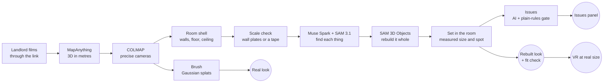

# SightSeen

**See the room before you sign.** A landlord films a room with one link. SightSeen turns the video into a 3D room at
real size that a student can walk around, measure, fill with their own things, check for red flags, and step into in VR.

Built for Meta's Global AI Developer Hackathon with MapAnything, SAM 3.1, Muse Spark and SAM 3D Objects.

## The problem

Students moving to a new city or country often sign for a room they've never seen. They can't afford the trip, so they
decide from a few photos. Then they find out the room is smaller than the ad said, their desk won't fit, or there's
damage nobody showed them. Rental scams aimed at students work the same way: a convincing listing, and no way to check.

## What SightSeen does

1. **One link, no app.** The student starts a request and texts the landlord a link. The landlord films the room in the
   browser. A video filmed live in that page is marked as filmed live, which is much harder to fake than sending a copy
   of another listing's tour.
2. **The room in 3D, at real size.** MapAnything rebuilds the room in metres from the video. Every measurement says how
   sure it is, and one tape-measured length (typed on the page) sets the whole room's scale.
3. **Two ways to see it.**
   - **Real:** Gaussian splats that look like the video. You step between the spots the phone filmed from, so every
     view looks like the real room.
   - **Rebuilt:** every piece of furniture found by Muse Spark and SAM 3.1 and rebuilt whole by SAM 3D Objects, so you
     can walk anywhere and move things around.
4. **Will my stuff fit?** Photograph your own desk or chair, give its longest side, and SAM 3D builds it at that size.
   It lands on free floor, and as you drag it, it tells you how much room it has: "It fits: 24 cm to the bed, 31 cm to
   the nearest wall", or "It runs 8 cm into the desk".
5. **Issues mode: flag less, and be right.** Plain rules sit on top of the AI:
   - **Damage** (mould, stains, cracks, holes) shows only when SAM 3.1 outlines it in at least 2 frames, from views at
     least 20 cm apart or 10° round, landing within 25 cm of each other. Everything that failed the gate is listed
     with the rule it failed.
   - **Never filmed:** walls and ceiling the video never showed, outlined in 3D, minus what furniture hides.
   - **Size against the ad:** the measured floor area against the listing's claim, and it refuses to judge while the
     scale is too rough.
   - **How the video came in:** filmed live through the link, sent as a file, or uploaded by the student.
6. **Step inside in VR.** In a Meta Quest's browser, Enter VR puts you in the room at its real size, where the video
   began. Walk with the left stick, turn with the right, and point the trigger at two spots to measure in metres.

## How it works

| Meta model | What it does in SightSeen |
|---|---|
| **MapAnything** (open weights, Apache 2.0 checkpoint) | Rebuilds the room in metres from the video's frames |
| **SAM 3.1** (Meta Model API) | Outlines each thing, wall plate and possible damage by name, in every frame |
| **Muse Spark** (Meta Model API) | Looks over the whole video and lists the room's things and possible damage |
| **SAM 3D Objects** (open weights) | Rebuilds each thing whole from one photo, on every side, at its measured size |

The whole pipeline after the 3D step runs on its own (`worker/pipeline.py`): the walls' photos, the scale check, the
things found, rebuilt and placed, then the issues. On this PC's 8 GB RTX 3070 it runs SAM 3D one model part at a time.
In the cloud (`worker/modal_app.py`), each thing builds on its own GPU at once.

## What makes it trustworthy

- **Every size says how sure it is.** "Rough, from 2 wall plates (±40%)" or "checked with a tape measure". Wall plates
  only change the scale when two or more agree. One tape-measured length beats everything.
- **The gate is plain code.** An AI flag that appears in one frame only, or from one viewpoint seen twice, never
  reaches the student.
- **Assumptions are labelled.** A ceiling the video never filmed says "assumed". A measurement that reaches it says so.

## Research behind it

I read these papers before and during the build. Here's what each one does, what SightSeen takes from it, and why I
picked it over the other options.

**MapAnything** (Meta, [arXiv 2509.13414](https://arxiv.org/abs/2509.13414)). Turns photos into a 3D scene in metres,
with every camera's position. It's the core of SightSeen.
- Why this one: a student needs real sizes, and MapAnything gives metres straight away. VGGT (also Meta) gives the
  shape but not the real size. MASt3R gives metric 3D too, but its code is non-commercial only.

**SAM 3** (Meta, [arXiv 2511.16719](https://arxiv.org/abs/2511.16719)), as SAM 3.1 on the Meta Model API. Outlines
every object that matches a short phrase like "door" or "water stain".
- Why this one: SAM 2.1 needs a click or a box for each object. SAM 3 takes words, so nobody has to click.

**COLMAP** (Schönberger and Frahm, CVPR 2016), through pycolmap. Solves every camera together, so the views line up to
under a pixel.
- Why: my splats were blurry. Same frames, same trainer, only the cameras swapped: on frames the trainer never saw,
  COLMAP's cameras scored 31.2 dB PSNR and MapAnything's 21.4. MapAnything's depth still gives COLMAP its metres.

**VGGT-Long** ([arXiv 2507.16443](https://arxiv.org/abs/2507.16443)). Lines up the parts of a long video. SightSeen
lines every part up with one run over the whole video instead of the one before, which kept sizes within about 1%
instead of drifting by up to 5%.

**UniMetric** ([arXiv 2610.16945](https://arxiv.org/abs/2610.16945)) and **G4Splat**
([arXiv 2510.12099](https://arxiv.org/abs/2510.12099)): the ideas behind checking scale with things of known size, and
filling what no camera saw. Taken as ideas, not code.

## Run it

One-time setup of the 3D helper, from `worker/` in Git Bash: `bash setup.sh`. Then three terminals:

1. 3D helper: `worker\run.ps1` (http://127.0.0.1:8001)
2. Spring Boot: `mvn spring-boot:run` (http://localhost:8080)
3. Frontend: `cd frontend`, then `npm install` and `npm run dev` (http://localhost:5173)

Keys go in `.env` (see `.env.example`): `MODEL_API_KEY` for the Meta Model API, `HF_TOKEN` for SAM 3D's weights.

**Stack:** Spring Boot (Java 25), React + TypeScript + three.js + Spark (splats) + WebXR, Python (FastAPI, Open3D,
PyTorch), Modal for the cloud GPUs.

## Licence

To be chosen before submission.
